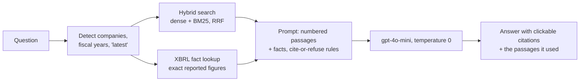

# FilingLens — cited answers from SEC 10-K filings

[](https://github.com/kxianggen/sec-rag/actions/workflows/ci.yml)

**Live demo: [filinglens-wtl8.onrender.com](https://filinglens-wtl8.onrender.com)** · runs on a free
instance, so the first question after a quiet spell can take about a minute while it wakes up.

Ask questions about six US semiconductor companies' annual reports — NVIDIA, AMD, Micron,
Broadcom, Qualcomm and Marvell, fiscal years 2023–2026 — and get answers that use **only** the
filings, cite every claim, and say *"Not in the filings."* when the answer isn't there.

| | Questions | Answer score | CRAG score | Wrong answers |
|---|---|---|---|---|
| Starting point (dense retrieval) | 30 (dev) | 0.55 | +0.32 | 7 |
| **Final system** | **30 (dev)** | **0.77** | **+0.70** | **2** |
| **Final system, held-out** | **11 (written after the system was frozen, run once)** | **0.82** | **+0.73** | **1** |

Graded by an LLM judge (gpt-4o) against a written rubric; the judge agrees with my blind hand
labels on **15 of 17** answers (0.88). Details in [Evaluation](#evaluation).

## How it works



- **Corpus:** 18 10-K filings (6 companies × 3 years) from SEC EDGAR, split into Items
  (Business, Risk Factors, MD&A, Financial Statements, …) and packed into **8,883 chunks**.
  Every table row is rewritten as a self-contained line — *"Total debt principal outstanding
  (in millions): November 2, 2025 = $67,120; November 3, 2024 = $69,847"* — so a number never
  loses its label or its year.
- **Contextual headers:** each chunk is searched with a header such as *"NVIDIA 10-K fiscal 2026 ·
  Item 7 Management's Discussion and Analysis · Results of Operations"*.
- **Hybrid search:** all-MiniLM-L6-v2 embeddings (384-d) for meaning + a BM25 keyword index for
  exact terms, merged with reciprocal rank fusion. Company, fiscal-year and "latest filing"
  filters; one search per company for comparison questions; finance abbreviations expanded
  (R&D → research and development).
- **Structured facts:** 21,821 numbers read from the filings' inline **XBRL** tags (e.g.
  `us-gaap:Revenues`, company-wide, full year). For number questions the exact figure is added to
  the prompt as its own citable source — XBRL separates a company's total from its segments,
  which text search kept confusing.
- **Two interchangeable vector stores:** in-memory numpy, or **pgvector on Supabase (Postgres)**
  with filters in SQL — verified to return identical results on all 30 questions.
- **Serving:** FastAPI (`POST /ask`, `GET /health`), input validation, per-visitor and daily rate
  limits, a plain HTML page that inserts model output as text only (no HTML injection).
- **Deployment:** Docker image on Render. Questions are embedded with **ONNX Runtime** instead of
  PyTorch — same model, cosine similarity 1.000000 on all 41 test questions, identical retrieval —
  which cut memory from **452 MiB to 223 MiB** so it fits a 512 MB free instance.

## Evaluation

**Golden set (dev):** 30 questions I wrote — 7 fact, 6 cross-period, 6 cross-company,
7 narrative, 4 unanswerable — each answer looked up in the raw filing with a verbatim quote.
Each question also lists the **required facts** it asks for, so answers aren't marked down for
leaving out background the question never asked about.

**Held-out set:** 11 new questions (including metrics the fact lookup doesn't cover, and two
traps: the filing never names TSMC; NVIDIA's 10-K never mentions HBM), written after the system
was frozen and run exactly once. Score 0.82 vs 0.77 on dev — no sign of overfitting to the 30.

**Metrics**
- **Answer score:** correct 1 · partial 0.5 · incorrect 0 (rubric categories A–E adapted from
  OpenAI's fact-grading eval: a subset of the required facts = partial; contradicting them = incorrect;
  a figure outside rounding, e.g. "$8.4B" for $8,091M, = incorrect).
- **CRAG score:** correct +1 · partial +0.5 · refusal 0 · **wrong −1** — makes a confident wrong
  answer cost more than "I don't know".
- **Recall@10** (right company + filing + Item retrieved) and **evidence hit** (the exact golden
  quote found in a retrieved chunk) — two levels of retrieval quality.
- **Judge validation:** I labelled 17 answers blind; the judge agreed on 15. Both disagreements
  were the judge being stricter than the rubric, so reported scores lean conservative.

**Experiments** (30 dev questions, all re-graded with the final rubric). Each row is one change on top of
the system adopted so far:

| Change | Answer | CRAG | Wrong | Decision |
|---|---|---|---|---|
| Baseline: dense retrieval, paragraph chunks | 0.55 | +0.32 | 7 | — |
| Section cap (≤ 3 chunks per section) | 0.62 | +0.48 | 4 | not adopted (decided under the first rubric, where it gained nothing); a blind rule that inflates recall |
| **Hybrid search (dense + BM25, RRF)** | 0.63 | +0.47 | 5 | **adopted** |
| Hybrid + section cap | 0.57 | +0.33 | 7 | not adopted |
| Table rows as self-contained lines | 0.62 | +0.48 | 4 | tested with headers ↓ |
| **Table rows + contextual headers** | 0.67 | +0.60 | 2 | **adopted** |
| Abbreviation expansion | 0.67 | +0.57 | 3 | **adopted** — fixed retrieval for its target (evidence 0 → 1); the −1 is answer noise on unchanged retrieval |
| LLM query rewriter (per company × year) | 0.68 | +0.52 | 5 | not adopted: splitting by year hid tables that show both years |
| LLM query rewriter v2 (per company) | 0.63 | +0.50 | 4 | not adopted |
| Prompt rule: copy numbers exactly | 0.65 | +0.55 | 3 | not adopted: the model broke the rule it was given |
| **XBRL facts in the prompt** | **0.77** | **+0.70** | **2** | **adopted** |

From the query-rewriter experiments on, a change was adopted only if it beat the current system on
both CRAG and wrong answers — a rule set before seeing the numbers. The rubric itself changed once
(v1 → v2.1, adding required facts and a stronger judge); every earlier run was re-graded so the
whole table uses one ruler. Answers run at temperature 0; even so, about one question per run flips by
chance, so changes smaller than ~0.03 are treated as noise.

Earlier stages on a 12-question set (dense filters, multi-year detection, per-company retrieval,
fixed vs paragraph chunking, 5 vs 10 chunks) and everything that went wrong are logged in
[FAILURES.md](FAILURES.md).

## What it can't do (yet)

- **Questions that name no company** search all six at once; a company that mentions a topic
  often can crowd out the others (held-out: found Micron's HBM mentions, missed Marvell's).
- **Metrics outside the fact list** rely on text search, where a neighbouring table row can be
  picked (held-out: "cash, cash equivalents and restricted cash" instead of "cash and cash equivalents").
- **No follow-up questions:** each question is answered on its own.
- Snapshot of filings downloaded September 2026; Intel was dropped because its filing structure
  defeats the section parser (FAILURES #1).

## Run it locally

```bash
uv sync
cp .env.example .env            # add OPENAI_API_KEY (and DATABASE_URL for the pgvector store)
uv run python ingest.py         # download the 10-K filings from EDGAR
uv run python extract.py                       # text split into Items -> data/text (xbrl.py reads fiscal years here)
uv run python extract.py --out data/text_tables # the same, in the folder chunk.py reads below
uv run python chunk.py --text data/text_tables --headers --out data/chunks_tables_hdr.jsonl
uv run python embed.py --chunks data/chunks_tables_hdr.jsonl --out data/embeddings_tables_hdr.npy
uv run python finalize_index.py && uv run python xbrl.py
uv run uvicorn app:app          # http://localhost:8000
uv run python eval.py           # the 30-question evaluation (~30 US cents with the gpt-4o judge)
```

Or with Docker: `docker build -t filinglens . && docker run -p 8000:7860 --env-file .env filinglens`.

**Stack:** Python · FastAPI · sentence-transformers / ONNX Runtime · BM25 · numpy · Postgres +
pgvector (Supabase) · OpenAI API · Docker · Render · GitHub Actions (CI: compile check + unit tests on every push)

Built by Kong Xiang Gen.
