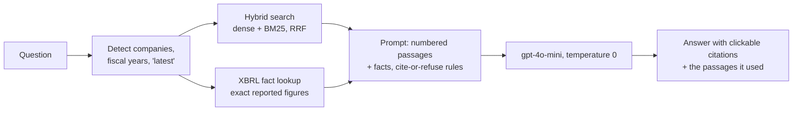

# FilingLens

[](https://github.com/kxianggen/sec-rag/actions/workflows/ci.yml)

Ask questions about chip makers' annual reports and get answers you can actually check: every
claim links back to the passage in the filing it came from.

**Try it: [filinglens-wtl8.onrender.com](https://filinglens-wtl8.onrender.com)** (it runs on a free
server, so the first question after a quiet spell can take about a minute while it wakes up).

FilingLens covers the 10-K filings of six US semiconductor companies (NVIDIA, AMD, Micron,
Broadcom, Qualcomm and Marvell) for fiscal years 2023–2026. It only answers from those filings.
If the answer isn't in them, it says *"Not in the filings."* instead of guessing.

## Using it

- Type a question, or pick a suggested one. They're grouped by topic: comparisons, numbers and
  trends, what the filings say, and a few that it should refuse.
- Each answer shows its top sources as cards above the text. Click a number in the answer to jump
  to the exact passage. Exact figures from the filings' XBRL financial data are labelled
  separately from text passages, so you can tell a reported number from a quoted sentence.
- Past questions are kept in your browser's history, and reopening one doesn't ask the model again.
- Works on phones and in dark mode.

For example, *"Which spent more on R&D in its latest fiscal year, NVIDIA or AMD?"* gets NVIDIA,
with $18,497 million in fiscal 2026 against AMD's $8,091 million in fiscal 2025, with both figures
cited.

## How well it works

I wrote 30 test questions by hand and looked up every answer in the original filings. After
freezing the system, I wrote 11 new questions and ran them exactly once, to make sure I hadn't
just tuned it to my own test set.

| | Questions | Answer score | CRAG score | Wrong answers |
|---|---|---|---|---|
| Starting point (dense retrieval) | 30 (dev) | 0.55 | +0.32 | 7 |
| **Final system** | **30 (dev)** | **0.77** | **+0.70** | **2** |
| **Final system, held-out** | **11 (written after the system was frozen, run once)** | **0.82** | **+0.73** | **1** |

- **Answer score:** 1 for correct, 0.5 for partly correct, 0 for wrong. A figure outside rounding
  (say "$8.4B" for $8,091M) counts as wrong.
- **CRAG score:** a stricter version where a wrong answer costs −1 but "I don't know" costs 0,
  so a confident mistake hurts more than an honest refusal.
- Each question lists the facts it actually asks for, so an answer isn't marked down for skipping
  background nobody asked about.
- An LLM judge (gpt-4o) does the grading against a written rubric, adapted from OpenAI's
  fact-grading eval. To check the judge, I labelled 17 answers myself without seeing its grades,
  and we agreed on 15. In both disagreements the judge was stricter than the rubric, so if
  anything the scores lean low.
- The held-out set includes two trick questions: the filings never name TSMC, and NVIDIA's 10-K
  never mentions HBM.

## How it works



- **The data.** 18 filings from SEC EDGAR, split into their sections (Business, Risk Factors,
  MD&A, Financial Statements and so on) and cut into **8,883 chunks**. Tables are rewritten row
  by row, so a line like *"Total debt principal outstanding (in millions): November 2, 2025 =
  $67,120; November 3, 2024 = $69,847"* never loses its label or its year. Each chunk also carries
  a short header such as *"NVIDIA 10-K fiscal 2026 · Item 7 Management's Discussion and Analysis ·
  Results of Operations"*.
- **Search.** Two searches run side by side: embeddings (all-MiniLM-L6-v2) for meaning, and BM25
  for exact words. Their results are merged with reciprocal rank fusion. The question is checked
  for company names, fiscal years and "latest", so the search only looks in the right filings.
  Comparison questions search each company separately, and common abbreviations are expanded
  (R&D → research and development).
- **Exact numbers.** Text search kept mixing up a company's total with one of its segments. So I
  also pulled **21,821 numbers** from the filings' inline XBRL tags (like `us-gaap:Revenues`,
  company-wide, full year). For number questions, the exact figure goes into the prompt as its own
  citable source. This was the biggest single improvement.
- **Answering.** gpt-4o-mini at temperature 0, told to cite every claim or refuse.
- **Storage.** The vectors can live in memory (numpy) or in Postgres with **pgvector on
  Supabase**. Both return identical results on all 30 test questions.
- **Serving.** FastAPI (`POST /ask`, `GET /health`) with input checks and rate limits per visitor
  and per day. The page is a single HTML/CSS/JS file with no framework, and it inserts model
  output as plain text only, so nothing can inject HTML into it.
- **Deployment.** A Docker image on Render's free tier. Questions are embedded with **ONNX
  Runtime** instead of PyTorch: same model, cosine similarity 1.000000 on all 41 test questions,
  identical retrieval, and memory down from **452 MiB to 223 MiB**, enough to fit in 512 MB.

## What I tried

Each row is one change on top of whatever had been kept before it, scored on the 30 dev questions
(all re-graded with the final rubric):

| Change | Answer | CRAG | Wrong | Result |
|---|---|---|---|---|
| Baseline: dense retrieval, paragraph chunks | 0.55 | +0.32 | 7 | starting point |
| Section cap (≤ 3 chunks per section) | 0.62 | +0.48 | 4 | dropped: a blunt rule that inflates recall, and it gained nothing under the first rubric |
| **Hybrid search (dense + BM25, RRF)** | 0.63 | +0.47 | 5 | **kept** |
| Hybrid + section cap | 0.57 | +0.33 | 7 | dropped |
| Table rows as self-contained lines | 0.62 | +0.48 | 4 | tested together with headers ↓ |
| **Table rows + contextual headers** | 0.67 | +0.60 | 2 | **kept** |
| Abbreviation expansion | 0.67 | +0.57 | 3 | **kept**: it fixed retrieval for the question it targeted; the extra wrong answer was noise, with retrieval unchanged |
| LLM query rewriter (per company × year) | 0.68 | +0.52 | 5 | dropped: splitting by year hid tables that show both years |
| LLM query rewriter v2 (per company) | 0.63 | +0.50 | 4 | dropped |
| Prompt rule: copy numbers exactly | 0.65 | +0.55 | 3 | dropped: the model broke the rule anyway |
| **XBRL facts in the prompt** | **0.77** | **+0.70** | **2** | **kept** |

A few ground rules I followed:

- From the query rewriter onwards, a change was kept only if it beat the current system on both
  CRAG score and wrong answers. I set that rule before seeing the numbers.
- The rubric changed once (v1 → v2.1, adding required facts and a stronger judge), so I re-graded
  every earlier run to keep the whole table on the same scale.
- Even at temperature 0, about one question per run flips by chance, so I treat differences
  smaller than ~0.03 as noise.
- Besides the answer scores, I tracked retrieval on its own: **Recall@10** (was the right
  company, filing and section retrieved?) and **evidence hit** (was the exact quote retrieved?).

Earlier experiments on a 12-question set (filters, multi-year detection, per-company retrieval,
chunk sizes, 5 vs 10 chunks), along with everything that went wrong, are in
[FAILURES.md](FAILURES.md).

## Known limits

- **Questions that name no company** search all six at once, and a company that mentions a topic
  a lot can crowd out the others. In the held-out set, it found Micron's HBM mentions but missed
  Marvell's.
- **Numbers outside the XBRL fact list** rely on text search, which can grab a neighbouring table
  row ("cash, cash equivalents and restricted cash" instead of "cash and cash equivalents").
- **No follow-up questions:** each question is answered on its own.
- The filings are a snapshot from September 2026. Intel was dropped because its filing layout
  breaks the section parser (FAILURES #1).

## Run it yourself

```bash
uv sync
cp .env.example .env            # add OPENAI_API_KEY (and DATABASE_URL for the pgvector store)
uv run python ingest.py         # download the 10-K filings from EDGAR
uv run python extract.py                       # text split into Items -> data/text (xbrl.py reads fiscal years here)
uv run python extract.py --out data/text_tables # the same, in the folder chunk.py reads below
uv run python chunk.py --text data/text_tables --headers --out data/chunks_tables_hdr.jsonl
uv run python embed.py --chunks data/chunks_tables_hdr.jsonl --out data/embeddings_tables_hdr.npy
uv run python finalize_index.py && uv run python xbrl.py
uv run uvicorn app:app          # http://localhost:8000
uv run python eval.py           # the 30-question evaluation (~30 US cents with the gpt-4o judge)
```

Or with Docker: `docker build -t filinglens . && docker run -p 8000:7860 --env-file .env filinglens`.

**Stack:** Python · FastAPI · sentence-transformers / ONNX Runtime · BM25 · numpy · Postgres +
pgvector (Supabase) · OpenAI API · Docker · Render · GitHub Actions (compile check and unit tests
on every push)

Built by Kong Xiang Gen.
